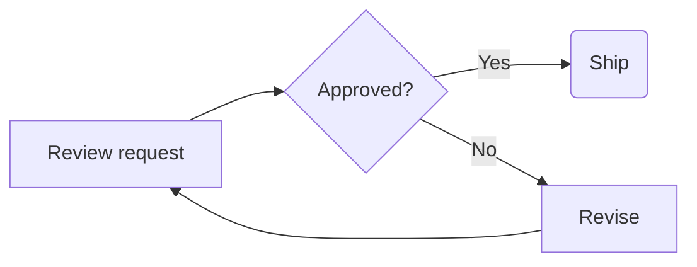

# Diagram feature review for FigCraft

Reviewed 2026-11-18 using FigCraft source and Visual Paradigm Community Edition (CE) 18.1 as a workflow reference.

**Recommendation.** Build the first release on FigCraft Boards. Let users choose the type of the next connected shape, insert an editable flowchart from text, and arrange selected shapes by their connections. Follow with class and entity relationship diagrams, then add behavior and systems diagrams using the same editor and a shared model where the notation requires one.

**Evidence.** The installed Visual Paradigm project browser displayed diagrams grouped by type, including class, sequence, and entity relationship diagrams. An activation reminder blocked the live editing session. The Visual Paradigm procedures and edition coverage below come from its public guides and comparison table. FigCraft behavior comes from the repository and existing tests. The proposed command names, layouts, and release sequence are design decisions. [FigCraft clean-room rules](../AGENTS.md#clean-room) · [Visual Paradigm edition comparison](https://www.visual-paradigm.com/support/edition-comparison.jsp)

## Create and edit a diagram in Visual Paradigm

1. Open a project and choose **Diagram → New**. Select the diagram type, choose a blank start or a template where offered, then name the diagram. Use **Location** to store it under an existing model or package when appropriate.
2. Place the first element from the diagram palette. Add its name and any attributes or properties in the element editor.
3. To continue a flow, drag the source shape’s connection handle to a blank spot and choose the target shape and relationship from the offered choices. To join existing elements, drag to the target and choose a compatible relationship. Visual Paradigm calls this the **Resource Catalog**.
4. Add labels, guards, multiplicities, or other notation-specific details. Use the layout menu when the diagram needs rearranging. The guide documents orthogonal, hierarchical, tree, and other layouts, with options depending on the layout.
5. Save the project. Use the **Project Browser** to reopen a diagram and **Project → Export** for shareable output. SVG and PDF carry visual output. XML and XMI are different export paths for exchanging model data. Test geometry and model coverage against a sample before committing to any importer.

[Creating diagrams](https://circle.visual-paradigm.com/docs/diagramming-and-modeling/diagram-editing/creating-diagrams/) · [Resource Catalog](https://circle.visual-paradigm.com/docs/diagramming-and-modeling/diagram-editing/resource-catalog/) · [Layout guide](https://circle.visual-paradigm.com/docs/diagramming-and-modeling/diagram-editing/applying-layout-to-shapes/) · [Export as images](https://circle.visual-paradigm.com/docs/export-and-import/export-as-images/exporting-multiple-diagrams-as-images/) · [XML](https://circle.visual-paradigm.com/docs/export-and-import/exporting/exporting-xml/) · [XMI](https://circle.visual-paradigm.com/docs/export-and-import/exporting/exporting-xmi/)

## Flowcharts and everyday diagrams

For each type, start with the common workflow above and use the following recipe. The FigCraft column describes how to construct it now where possible and what a dedicated feature would need. The vendor lists the desktop Flowchart Editor and Business Model Canvas in CE. Its comparison lists swimlane flowcharts under the web-compatible drawing catalog.

| Diagram | What to place and connect | How to build it in FigCraft |
| --- | --- | --- |
| Flowchart | Place a start, process steps, a decision with labeled outcomes, and an end. Route any retry arrow back to the step it repeats. | Use the existing Flow chart template or the Shapes and Connector tools. Add a shape picker to connected creation, text import, and directional graph layout. |
| Swimlane or cross-functional flowchart | Define lanes by role. Put each step in its owner’s lane and draw arrows across lanes at handoffs. | Use board sections as a manual sketch. A lane tool needs ordered lane containers, snap targets, lane headers, and connectors that reroute when a lane or step moves. |
| Block, system context, or architecture diagram | Put a system boundary on the canvas. Add services or external actors and label the information or dependency relationships. | Use sections, labeled shapes, and connectors. Add a palette of original symbols and layout within and across boundaries. |
| Mind or concept map | Start with a topic. Add children for ideas and link related ideas. Use named links when the relationship itself matters. | FigCraft already has mind-map creation and child/sibling commands. Expose these on the board toolbar and add reparenting. Use independent connectors for concept maps with cross-links. |
| Hierarchy, organization, family tree, or sitemap | Add a root, group nodes at each level, and connect parents to children. Represent multiple parents when the notation calls for it. | Use reusable cards and a tree layout for single-parent structures. Use graph layout for cross-links and multiple parents. |
| Business Model Canvas or affinity map | Establish named regions, then group sticky notes or items under each region. | Build a Board template from sections, stickies, and headings. Existing template and voting tools cover much of the workshop workflow. |

[Flowchart tutorial](https://www.visual-paradigm.com/guide/flowchart/flowchart-tutorial/) · [Edition comparison](https://www.visual-paradigm.com/support/edition-comparison.jsp) · [FigCraft Boards](boards-parity.md)

## UML diagrams

The vendor’s comparison lists all 13 UML diagram types below for CE. Choose the named type in **New Diagram**, then build it with its palette. The FigCraft column describes proposed structured support. Ordinary board shapes can sketch many of these today.

| UML diagram | How to draw it in Visual Paradigm | FigCraft implementation |
| --- | --- | --- |
| Use case | Place actors outside a system boundary and use cases inside. Connect participation, then add include or extend links where the model calls for them. | Boundary containers, actor and use-case shapes, typed links, and relationship labels. |
| Class | Add classes or interfaces. Fill in attributes and operations. Add associations, inheritance, or other relationships and enter multiplicities as applicable. | Class cards with editable member rows and typed endpoints. Support hollow arrowheads, diamonds, and labels at both ends. Keep references to shared class IDs. |
| Object | Place instance specifications, set their classifier and slot values, and connect instances with links. | Reuse class-style cards with instance IDs, a classifier reference, and name/value rows. |
| Component | Place software components and interfaces. Connect provided and required interfaces and show dependencies. | Component cards and named ports with distinct interface markers and typed links. |
| Deployment | Place devices and execution environments, nest artifacts, and draw communication paths. | Moveable nested containers, artifact placements, boundary ports, and communication links. |
| Package | Group model elements into packages and draw dependencies or imports between packages. | Package hierarchy in the model, a container view on the canvas, and typed dependencies. |
| Composite structure | Place parts inside a classifier, add boundary ports, and draw connectors between parts or ports. | Nested parts with independent IDs and named port anchors. Route inside and across the owning boundary. |
| Activity | Add initial and final nodes, actions, decisions, and forks or joins. Put actions in partitions when ownership matters. | Extend flowcharts with token-flow notation, guard labels, parallel bars, partitions, and activity-specific validation. |
| State machine | Place states and connect transitions. Add trigger, guard, and effect labels. Group nested states where needed. | State cards, transition labels, composite regions, and dedicated self-transition routing. |
| Sequence | Place participants across the top. Add lifelines and messages in top-to-bottom event order. Add activation bars and combined fragments as needed. | Use ordered events on a vertical timeline. Generate message positions and activation spans from event order. Support fragments and lifeline anchors. |
| Communication | Place objects or participants, connect them, and number the messages that travel along each connection. | Share participant and message semantics with sequence diagrams. Use free positioning and numbered link annotations. |
| Timing | Place lifelines or signals along a common horizontal time axis. Add state or value changes and timing constraints. | Use a time axis and editable tracks with ordered transitions and intervals. Render connectors and constraints against time coordinates. |
| Interaction overview | Draw a high-level control flow and put interaction uses or interaction fragments at selected steps. | Combine activity layout with references to existing interaction diagrams. Allow users to open the referenced diagram from its node. |

[Visual Paradigm UML diagram list](https://www.visual-paradigm.com/support/edition-comparison.jsp) · [Vendor class diagram walkthrough](https://circle.visual-paradigm.com/docs/uml-and-sysml/class-diagram/how-to-draw-a-class-diagram-in-uml/) · [OMG UML 2.5.1](https://www.omg.org/spec/UML/2.5.1)

## SysML diagrams

The following nine diagram types are listed in the vendor’s CE comparison. These recipes use the SysML 1.x diagram taxonomy. Implementing SysML 2.0 would require a separate language and interchange design.

| SysML diagram | How to draw it in Visual Paradigm | FigCraft implementation |
| --- | --- | --- |
| Requirement | Create requirement records with an ID and statement. Use relationships such as satisfy, verify, or derive to trace them. | Requirement cards with stable identifiers and references to design elements or test cases. Validate relationship endpoints. |
| Block definition | Define blocks, their value and part properties, and structural relationships. | Specialize class-style cards with block properties, types, and composition. |
| Internal block | Select the owning block, place its parts and ports, and connect compatible endpoints. | Specialize the composite structure editor with typed block parts and ports. Distinguish a block definition from each part that uses it. |
| Parametric | Place constraint properties and bind their parameters to the values they constrain. | Add typed constraint expressions and binding connectors. Store expressions as data. A solver would be a separate capability. |
| Activity | Sketch actions and decisions, then connect control or object flows and add partitions where useful. | Reuse UML activity layout and add SysML-specific properties and endpoint checks. |
| Sequence | Arrange system participants and their ordered messages. Add fragments for alternate or repeated interactions. | Reuse the timeline editor and bind lifelines to SysML participants or parts. |
| State machine | Define modes, transitions, and triggers for a system or block. | Reuse the state machine editor and associate each view with its owning block. |
| Use case | Identify system actors and goals, then connect them within a system boundary. | Reuse UML use cases and link the view to system elements and requirements when needed. |
| Package | Group related requirements, blocks, and behavior definitions into named packages. | Reuse the package tree and diagram view, with references to SysML elements. |

[Visual Paradigm edition comparison](https://www.visual-paradigm.com/support/edition-comparison.jsp) · [Requirement diagram guide](https://circle.visual-paradigm.com/docs/uml-and-sysml/requirement-diagram/how-to-draw-a-requirement-diagram/) · [OMG SysML 1.7](https://www.omg.org/spec/SysML/1.7/About-SysML) · [OMG SysML 2.0](https://www.omg.org/spec/SysML/2.0/)

## Database diagrams

Start an **Entity Relationship Diagram**, add entities, then choose relationship endpoints and multiplicities. The notation and level of detail determine how to represent the entities and relationships.

| Variant | How to draw it in Visual Paradigm | FigCraft implementation |
| --- | --- | --- |
| Conceptual | Name business entities and describe their relationships and cardinality. | Entity cards and labeled links with cardinality at both ends. |
| Logical | Add attributes, identifiers, optionality, and relationships. Introduce an associative entity when it clarifies many-to-many data. | Ordered editable attribute rows, key flags, typed column references where needed, and constraints. |
| Physical | Specify tables, columns, database types, primary and foreign keys, and nullability. Connect related columns. | Table cards, stable row IDs, row-level edge anchors, and crow’s-foot markers. Scope any SQL import or export to a defined dialect. |
| Chen notation | Use entity rectangles, relationship diamonds, and attribute ellipses. Attach attributes and cardinalities using the selected notation. | An alternate view of entity and relationship data. Render relationships as explicit nodes with incidences so a view can represent n-ary relationships. |

The vendor comparison lists conceptual, logical, and physical modeling and the Chen editor for CE. It lists synchronization across those three modeling levels in paid editions. Treat cross-level synchronization as a separate feature. [ERD drawing guide](https://circle.visual-paradigm.com/docs/database-design-engineering/database-designers-guide/how-to-draw-an-erd/) · [Edition comparison](https://www.visual-paradigm.com/support/edition-comparison.jsp)

## Other diagram families and edition boundaries

The vendor catalogs additional web-compatible drawings by family. Choose a blank canvas or a template through its online drawing workflow. Availability depends on edition and connectivity. Several families can share a FigCraft editor through reusable shapes, layouts, and templates. [Vendor drawing catalog and edition matrix](https://www.visual-paradigm.com/support/edition-comparison.jsp)

| Family | Example creation recipe | FigCraft implementation |
| --- | --- | --- |
| Software design | For integration or hexagonal architecture, group services by boundary, add adapter or messaging roles, and connect incoming and outgoing dependencies. | Architecture palette, labeled directed connectors, optional ports, nested sections. |
| Business design | For a context or information flow diagram, place a system or organization in the center and connect participants with named flows. Use sections and sticky notes for affinity diagrams. | Reusable graph layouts and template variants for grouped or radial arrangements. |
| Project management | For a dependency network, add tasks and connect prerequisites. For stakeholder or selection matrices, define axes and place entries. | Graph templates for dependencies and Board tables or section grids for matrices. Scheduling or critical-path calculations require task data. |
| Organizational | Put people or roles in levels and link reporting relationships. A family tree may require multiple parents. | Tree and graph layouts, role cards, reference links, and grouping. |
| Quality and process improvement | For PDCA or 5S, place named stages and add actions or observations to each. | Native templates with labeled areas, directional arrows, and stickies. |
| UX design | For a sitemap, add pages and hierarchical navigation. For wireframes, compose screens from reusable interface components. | Boards for navigation graphs, existing design frames and components for wireframes, and optional links between them. |
| Floor plans and seating | Draw walls to scale, then place doors, fixtures, and furniture. For seating, group seats into rows or tables. | Vector paths, snapping, dimensions, and original reusable symbols. Unit-aware editing is a prerequisite for a technical floor plan. |
| Network and cloud | Place devices or services in network zones and label connectivity. Use ordered slots for rack diagrams. | Nested containers, port anchors, reusable component symbols, and labeled routes. Rack slots need ordered placement rules. |
| Engineering | Place schematic symbols, then wire their pins. Distinguish a junction from a crossing. For process or piping diagrams, identify equipment and label flows. | Original or appropriately licensed symbol sets, port snapping, junctions, line styles, and explicit topology. Domain validation requires a defined notation and scope. |
| Brainstorming | Put a question or topic in the center, group ideas, then add branches, ranks, or category columns as the exercise calls for. | Combine mind maps, board templates, stickies, and tables. |
| Strategic analysis | Place observations into a named quadrant or grid, or arrange them along a perceptual map’s axes. | Resizable section grids, tables, templates, and labeled axes. |
| Data visualization | Choose a chart, enter categories and series, then label axes and legends. The CE column includes common bar, column, and line chart variants. | Dataset-driven chart geometry with explicit scales and accessible labels. Board tables can supply data. Treat chart editing as a separate renderer from graph layout. |
| Decision analysis | Place influences, alternatives, or driving and restraining forces and connect or group them. | Directed graph or matrix templates. Add numeric weighting only where the feature defines how to interpret it. |
| Problem solving | Start with a problem, add causes as linked nodes, or record structured 5W1H prompts. | Tree and graph templates with labeled connectors, or an editable table. |
| General drawing | Arrange labeled blocks, comparison matrices, or a branching key. | Existing board primitives and reusable templates. |

**Edition-dependent scope.** The comparison lists native BPMN, formal DFD, C4, organization chart, and mind-mapping tools under paid editions. Casual diagrams can have similar subject matter, such as a hand-drawn system context diagram or family tree. For FigCraft, a visual swimlane can start with Board sections. Standards-aware BPMN would add pools, lanes, events, tasks, gateways, sequence and message flows, validation, and a defined BPMN exchange profile. Formal DFD would require process, store, and external-entity types plus a named notation. [Vendor edition comparison](https://www.visual-paradigm.com/support/edition-comparison.jsp) · [OMG BPMN 2.0.2](https://www.omg.org/spec/BPMN/2.0.2)

## Make an editable flowchart in FigCraft today

1. Create a Board with **File → New board** or from the home screen.
2. Use **Templates → Flow chart** to start from a complete editable example. For a blank diagram, place shapes from the Board toolbar and type their labels.
3. Use **Connector** to join existing shapes. Use a selected shape’s **+** handle to create another shape already connected to it. Choose another shape type with the contextual bar when needed. Double-click a connector to give it a label.
4. Move or resize a shape and its attached connectors follow. Use the connector controls to change its style or move its ends. Use a heading or section to organize diagrams on a board.
5. Save the board as `.figcraft`. For a selection export, include the shapes, connectors, and connector labels. Labels are sibling layers. An export selection that includes only shapes and connectors can omit them.

The command surface can build a custom diagram with existing functionality. First call `file.newBoard` with `{"name":"Review workflow"}`. Then pass the following parameters to `command.batch` or to the MCP `batch` tool. The `$ref` values resolve the layer IDs returned by earlier steps.

```json
{
  "commands": [
    {
      "command": "board.shape",
      "as": "review",
      "params": {"shape": "rectangle", "x": 0, "y": 60, "width": 160, "height": 80, "text": "Review request"}
    },
    {
      "command": "board.shape",
      "as": "decision",
      "params": {"shape": "diamond", "x": 240, "y": 20, "width": 200, "height": 160, "text": "Approved?"}
    },
    {
      "command": "board.shape",
      "as": "ship",
      "params": {"shape": "roundedRectangle", "x": 540, "y": 60, "width": 160, "height": 80, "text": "Ship"}
    },
    {
      "command": "board.shape",
      "as": "revise",
      "params": {"shape": "rectangle", "x": 260, "y": 280, "width": 160, "height": 80, "text": "Revise"}
    },
    {"command": "board.connector", "params": {"from": {"$ref": "review"}, "to": {"$ref": "decision"}, "style": "elbow"}},
    {"command": "board.connector", "params": {"from": {"$ref": "decision"}, "to": {"$ref": "ship"}, "style": "elbow", "label": "Yes"}},
    {"command": "board.connector", "params": {"from": {"$ref": "decision"}, "to": {"$ref": "revise"}, "style": "elbow", "label": "No", "fromSide": "bottom"}},
    {"command": "board.connector", "params": {"from": {"$ref": "revise"}, "to": {"$ref": "review"}, "style": "elbow", "fromSide": "left", "toSide": "bottom"}}
  ]
}
```

[Board commands](mcp.md#boards) · [Batch step references](mcp.md#step-references) · [Existing flowchart template](../crates/engine/src/boards/board_templates.rs) · [Connector labels](../crates/engine/src/boards/board/edit.rs)

## How to implement the feature in FigCraft

### First release on Boards

- **Choose a connected shape.** Keep quick creation from the Board handle. Add a way to choose a different shape at the placement point. Extend the engine’s connected-shape command with optional target shape and label data. Use the existing endpoint selection and text editor. Creating the shape and arrow should take one undo step. [Board handles](../crates/ui-egui/src/canvas/board_connect.rs) · [Board shape creation](../crates/engine/src/boards/board/items.rs)
- **Insert from text.** Add **Insert diagram…** near **Templates** and expose it through Actions. A proposed `board.insertFlowchart` command takes source text and an optional position. Start with Mermaid flowchart directions `LR`, `TD`, and `TB`, rectangle, rounded rectangle, diamond, and directed edges with optional labels. Show parse errors with a line and column before changing the board. Use a bounded parser that handles labels as plain text and reports unsupported syntax. Resolve imported IDs before inserting. Keep board objects as the editable result after insertion. [Board picker](../crates/ui-egui/src/widgets/board_picker.rs) · [Mermaid flowchart syntax](https://mermaid.js.org/syntax/flowchart.html)
- **Arrange connected shapes.** A proposed `board.arrangeDiagram` command takes a selection and direction. Rank nodes from the graph, place them with deterministic spacing based on measured sizes, and allocate a channel for backward edges such as retry arrows. Treat disconnected components independently and preserve explicit diagram boundaries. Reuse connector geometry for attachment points. The existing router considers the two endpoint boxes, so avoiding other shapes requires explicit channel or obstacle routing. Existing **Tidy up** groups shapes by their positions. [Board routing](../crates/doc/src/board_route.rs) · [Tidy up](../crates/engine/src/selection/tidy.rs)

An example input for the proposed importer follows. The return from `Revise` to `Review` should stay legible after layout.



Keep the UI thin. Parse, validate, and lay out the graph in the engine, then create native Board shapes, connectors, and labels in a single undoable command. Return all created layer IDs, including labels, for selection, scripted edits, and export. For the first release, the persistent representation can remain the existing Board layers. Native save, copy and paste, undo, and live updates already use those layers and their metadata. Test the complete command through these paths. [Command architecture](architecture.md#commands-one-path-for-every-surface) · [Board data model](../crates/doc/src/board.rs) · [Execution and rollback](../crates/engine/src/session/exec.rs) · [Board collaboration tests](../crates/collab/src/board_sync_tests.rs)

### Structured diagrams and shared models

For class, ERD, and systems diagrams, define model elements and diagram views independently. A class or entity has a stable ID and typed members and relationships. Each appearance references that ID and owns its position, dimensions, and presentation. Renaming the shared element updates its appearances. Moving one appearance affects that diagram. Visual Paradigm documents this distinction in its Open API. [Visual Paradigm model and view](https://circle.visual-paradigm.com/docs/diagramming-and-modeling/visual-modeling/understanding-model-element-and-view/) · [Visual Paradigm Open API](https://circle.visual-paradigm.com/docs/open-api/introduction/introducing-plugin-development/)

Use one model and editor infrastructure with notation-specific rules. A relationship definition declares compatible endpoints, direction, markers, labels, and any special fields. Class members, database columns, and ports need stable IDs so moving or renaming them preserves attachments. Layout operates on the view and depends on the notation. Class relations use orthogonal routing, sequence messages use an event order, and timing diagrams use a shared time axis. Provide explicit operations to remove an appearance or delete its model element. Define the handling of other views and related edges before implementing deletion.

Keep model types in the document layer and mutations in engine commands. Derive rendered geometry from the model and view, and reuse FigCraft’s existing rendering and export pipeline where viable. New persistent metadata needs backward-compatible defaults and explicit collaboration, copy/paste, and undo behavior. Keep layout and semantic validation independent of egui so desktop, web, CLI, and MCP can share the feature. Use the same APIs for UI and headless callers. [FigCraft architecture](architecture.md) · [Board normalization](../crates/engine/src/derived.rs) · [Clipboard remapping](../crates/engine/src/cmd/edit/clipboard.rs)

### Import and export boundaries

| Use case | Format and expected behavior |
| --- | --- |
| Keep editing within FigCraft | Save a `.figcraft` file. Reopen with the same graph and connector attachments. |
| Share its appearance | Export SVG, PNG, or PDF through the existing export pipeline. |
| Bring in a visual reference from Visual Paradigm | Export SVG from Visual Paradigm and import it through FigCraft’s SVG workflow. The result is artwork. |
| Generate a native flowchart from text | Parse the supported Mermaid subset into native editable Board layers. A future source round trip would need explicit rules for edits made on the canvas. |
| Exchange UML model data | Evaluate XMI using small synthetic exports and explicitly supported UML elements. Confirm which IDs, relationships, and view geometry are available. |
| Exchange a specific Visual Paradigm project export | Evaluate documented XML export with synthetic examples. A compatibility layer would need format fixtures and fidelity checks. |

[FigCraft file I/O](architecture.md#file-io) · [Visual Paradigm XML export](https://circle.visual-paradigm.com/docs/export-and-import/exporting/exporting-xml/) · [Visual Paradigm XMI export](https://circle.visual-paradigm.com/docs/export-and-import/exporting/exporting-xmi/)

## Delivery order and verification

| Stage | Deliverable | Acceptance example |
| --- | --- | --- |
| 1. Flowcharts | Connected shape choice, text insertion, and directional auto-arrange on Boards | Create a review process with Yes and No branches and a retry loop. Move the decision and confirm that its arrows and labels follow. Undo the whole insertion in one step. |
| 2. Tree and container diagrams | Mind-map toolbar and editing, hierarchy layouts, and swimlanes | Reparent a mind-map branch. Move a task between lanes and confirm that cross-lane connections remain attached. |
| 3. Class and ERD modeling | Shared model IDs, structured member rows, typed links, ports, and cardinalities | Rename an entity or class from one view and see the label update in another. Move the second view independently. Reorder a column and check its connector. |
| 4. Behavior and systems modeling | Activity, state, sequence, timing, deployment and SysML-specific views | Show a sequence interaction with a nested fragment. Link a requirement to a design block and a verification case. Test a state with a self-transition. |
| 5. Templates and interoperability | Additional drawing libraries, model export or import profiles backed by fixtures | Open a synthetic interchange file and compare type, labels, edge endpoints, and available geometry. Export a selected graph and confirm all relationship labels are present. |

Verification for the first release should also cover malformed or oversized input with zero partial changes, repeated layout with deterministic results, Unicode labels, crossing or overlapping routes, copy into another Board, save and reopen, Linux or Windows desktop and web entry points, and convergence for two participants in a live session. Verify the visible result using a synthetic document. Existing template tests provide precedents for one-step undo and live sync. [Board template tests](../crates/engine/src/board_tables_tests.rs) · [Project rules and quality gates](../AGENTS.md#quality-gates-before-every-commit)

**Pending live reference check.** Once the installed Visual Paradigm editor is accessible, build the synthetic review flow and a two-class diagram. Check which choices the connection handle offers, how layout handles the return edge, and how a shared class behaves when it appears on two diagrams. These observations can refine the interaction design and verification examples.
