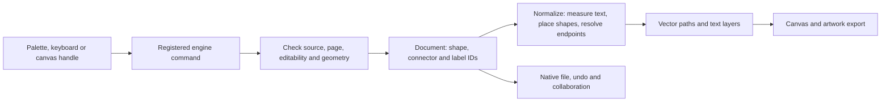

# Visual Craft flowchart implementation plan

**First milestone:** A tester can draw a branching process on a blank page, change their mind about a step, move it, undo an edit, reopen the file and share a diagram whose arrows and branch labels still tell the same story.

Reviewed on 2026-11-20 against the current FigCraft worktree and a separate instance of the available Windows debug build. **Visual Craft** is the product name used in this plan. Existing crate names, command IDs and the native `.figcraft` extension identify the implementation. Branding and a file-format rename are separate release decisions.

## What the board did in testing

| Priority | Observation and evidence | First change and acceptance test |
|---|---|---|
| **P1 · Connected step on the wrong page** | On a two-page scratch board, page two was active. Calling `board.addConnected` with a page-one source succeeded. Inspection showed the new diamond on page one, the arrow and its label on page two, and both arrow ends saved as free coordinates. The command takes the new shape's parent from the source and the arrow's page from the session. Normalization then correctly detaches off-page ends. Observed through the command API. The pointer chooser already checks which tab and page opened it. | Check `doc.page_of(from) == Some(s.page()?)` immediately after resolving the source and before ending a text edit. Reuse the same-page rule used by ordinary connectors. Test explicit IDs, a nested section on the active page, and an open text draft. Refusal must preserve both pages, selection, draft, history and outgoing edits. |
| **P1 · A branch label disappears from a selection export** | Exporting two steps and their connector as SVG with editable text produced “Intake” and “Release”. Adding the connector's label ID to the same export also produced “Yes”. The stored label is a sibling frame. The export honored the literal layer list, which loses meaning for someone sharing a flowchart. | Add a diagram export action that resolves selected steps, internal edges and their labels. Explicitly selected edges also bring their labels. Deduplicate in paint order. Keep the precise layer-export command available. Test the actual SVG text and inspect rendered PNG/PDF output. |
| **P2 · An automatic elbow can cross an unrelated step** | Between two horizontal steps the elbow ran from x=134 to 556 at y=140. A third box covered x=220–380 and y=80–200. Its intersection with the line and the “Yes” label was visible in the document geometry. Dragging the third box away changed its position without changing the route. This is a limitation of the current two-endpoint router. | Add obstacle-aware routing for automatic elbows and reposition their labels. Test both directions of the edit, moving an obstacle into and out of an existing route with stationary endpoints. |
| **P2 · Quick-create previews the wrong outline** | Source inspection shows the chooser uses the chosen size but calls `ghost_box` for every highlighted row. A Decision therefore previews as a rectangle before committing a diamond. This was traced in the UI code. | Draw the preview from the same shape geometry used at commit. Headlessly exercise the chooser and visually check Decision, Terminator and Same Shape at two zoom levels. |
| **P2 · Label entry points disagree** | A 121-character label was rejected by `board.addConnected` and accepted by `board.label` on the same board. The latter yielded a 981-unit-wide label. The general connector constructor also passes text directly to `set_label`. | Use the existing 120-character quick-create limit for new flowchart branch captions across the chooser, command and inline edit. Specify Unicode counting, preserve older long values on load, allow shortening them, and keep plain-board caption behavior compatible. Wrap or constrain long captions visually. |

**What worked.** A pointer drag moved the third box. Deleting the connector removed its label, and one undo restored both. A native save opened from a separate copy with zero reported repairs, the same two attached endpoint IDs and the caption “Yes”. Explicitly including the complete set of layers produced SVG, PNG and PDF files. Visual inspection of the PNG and rendered PDF confirmed both step names, the arrowhead and “Yes”. The SVG comparison above used actual text elements. Simultaneous edits still need their own acceptance run.

## Visual Paradigm benchmark

Use these as observable tasks for side-by-side testing. The Online editor is the primary product reference. Its public feature lists describe capabilities across offerings. The desktop tutorial is an additional reference for diagram notation and the connected-creation workflow. Edition availability and individual toolbar gestures still need direct checking before claiming parity.

| Workflow | Visual Craft baseline | Work needed to meet the benchmark |
|---|---|---|
| Start with a blank canvas or an example | Both work. The sample already has two labeled decision branches and a return loop. | Prioritize a small discoverable flowchart palette, an original example and a cross-functional starter. Compare time to first completed branch. |
| Draw the right symbol and continue from it | 23 general board outlines. Quick-create offers Same Shape, Process, Decision and Terminator. Document, database, parallelogram and predefined process geometry already exist. | Name shapes by flowchart meaning, offer them from both entry points and share their previews. Add delay and continuation symbols. Support click, drag to an existing step, keyboard selection and Escape. [Symbols and connected drawing](https://www.visual-paradigm.com/tutorials/flow) |
| Revise a connected chart | Existing attached ends, free ends, side selection, manual reshaping, arrowheads, colors, stroke/dash, shape changes and label editing. | Label a branch during creation, insert a step into an existing arrow, reset a manual route, avoid unrelated steps, and add an optional branch check. Desktop documents splitting for certain connector types. Treat flowchart splitting as a Visual Craft feature to qualify independently. [Resource Catalog](https://circle.visual-paradigm.com/docs/diagramming-and-modeling/diagram-editing/resource-catalog/) |
| Arrange and format a diagram | Generic board positioning, snapping, alignment and distribution are reusable. Automatic graph arrangement and text-to-flowchart insertion are specified in this repo and have no registered command in the reviewed tree. | Expose alignment and distribute tools in context. Add explicit left-to-right and top-to-bottom graph layout with stable branch order and return routes. Reuse style copying and add reusable process styles after measuring the manual workflow. [Online editing features](https://online.visual-paradigm.com/diagrams/solutions/free-flowchart-editor/) |
| Explain who owns work and where it continues | Board sections and pages exist. A normal attached connector is page-local. | Give lanes ownership, headers and ordering. Give on/off-page references a navigable pair independent of geometric arrows. [Swimlane diagrams](https://online.visual-paradigm.com/diagrams/features/flowchart-tool/swimlane-diagram-tool/) · [Off-page reference example](https://online.visual-paradigm.com/diagrams/templates/flowchart/flowchart-off-page-connector-example/) |
| Share and exchange | Native editable save and artwork export exercised. Existing board collaboration and comments offer a starting point. | Qualify complete-graph export, comments and two-client edits on flowcharts. Track stencil/Visio import, reusable custom shapes, richer text/images/links, JPG/GIF, Office embedding and cloud workspace integration individually as later parity items. Each needs a fixture, supported edition and fidelity check before claiming support. [Online flowchart editor](https://online.visual-paradigm.com/diagrams/solutions/free-flowchart-editor/) · [Flowchart product features](https://online.visual-paradigm.com/diagrams/features/flowchart-tool/) |

## How a connected edit travels through Rust

**Keep one editable representation.** A flowchart step is an ordinary Board shape with child artwork and text. An arrow stores each end as an attached node or a free point. A label frame refers to its connector ID. Use these IDs for selection, undo, persistence and collaboration. Construct a temporary directed graph when a command needs to find branches, arrange steps or determine what to export. This preserves the existing board editing tools and the files the first testers already have.

## File-by-file implementation map

Paths are relative to the repository. Proposed files are marked **new**. The map follows the production path for flowcharts and its relevant shared facilities.

| Existing file | Responsibility today | Planned change or protection |
|---|---|---|
| [doc/src/board.rs](../crates/doc/src/board.rs) | Board style, shape IDs and outlines, endpoint and manual-path types | Reuse geometry and saved IDs. Add flowchart-specific symbol mappings and optional reference/lane metadata only when the feature needs persistence. Give old files defaults. |
| [doc/src/board_route.rs](../crates/doc/src/board_route.rs) | Endpoint anchors, gaps, orthogonal segments, curves and saved manual runs | Keep it the source for attachment points and reconstruction. Keep the current endpoint-only route as a bounded fallback. |
| [engine/src/cmd/file.rs](../crates/engine/src/cmd/file.rs) | Validates diagram type/template and opens a diagram-styled Board | Use its public creation path in all fixtures. Register additional flowchart starters here using existing template validation. |
| [engine/src/boards/board_templates.rs](../crates/engine/src/boards/board_templates.rs) | Builds the example from native shapes and connectors | Reconcile the meaning of its ellipse Start/Done and rounded process steps with the chooser's Terminator. Preserve the existing example's branch directions. |
| [engine/src/boards/board.rs](../crates/engine/src/boards/board.rs) | Board command registry and parameter readers | Register the small number of new commands here. Document parameter defaults, result IDs and read-only behavior. |
| [engine/src/boards/board/items.rs](../crates/engine/src/boards/board/items.rs) | Builds shapes, computes connected placement and runs validation before committing an active text edit | Fix page membership here first. Reuse its measured sizing, `connected_place`, `connected_size` and transaction boundary when extending the chooser. |
| [engine/src/boards/board/connectors.rs](../crates/engine/src/boards/board/connectors.rs) | Validates ends, creates an arrow and reattaches it | Share page checks and label policy. Use its endpoint and cap logic for insert-on-edge. |
| [engine/src/boards/board/edit.rs](../crates/engine/src/boards/board/edit.rs) | Creates and finds sibling label frames, restyles shapes and remaps copied Board objects | Resolve labels from connector IDs. Preserve text on shape changes. Reuse copy remapping for lanes and page references. |
| [engine/src/boards/board/tools.rs](../crates/engine/src/boards/board/tools.rs) | Canvas hit tests and connector tool interactions | Share eligible targets and attachment calculations with previews. Test nested, rotated and locked targets using each tool's documented behavior. |
| [engine/src/boards/board/reshape.rs](../crates/engine/src/boards/board/reshape.rs) | Dragging an elbow segment or a curve handle writes a manual path | Add an explicit reset-to-automatic command. Automatic routing must respect hand-authored paths. |
| [engine/src/boards/board/derived.rs](../crates/engine/src/boards/board/derived.rs) | Recomputes touched routes, detaches vanished ends, places midpoint labels | For automatic obstacle avoidance, consider an obstacle's old and new bounds and connectors affected by either. Keep label placement downstream of final route geometry. |
| [engine/src/derived.rs](../crates/engine/src/derived.rs) | Orders text, layout and route normalization | Supply measured, final-world bounds before routing. Exercise move, resize, undo and remote patch entry points. |
| [engine/src/session/exec.rs](../crates/engine/src/session/exec.rs) | Command checks, history, rollback and journal | Each gesture commits one undoable mutation. Preserve a text draft on refusal. Bound and omit large import source in journaling and repeat handling per the existing import plan. |
| [engine/src/cmd/arrange.rs](../crates/engine/src/cmd/arrange.rs) and [canvas/snap.rs](../crates/engine/src/canvas/snap.rs) | Generic alignment and snapping | Expose existing operations in flowchart UI. Introduce graph layout as its own command because it also computes edge directions and loop routes. |
| [ui-egui/src/dialogs/new_diagram.rs](../crates/ui-egui/src/dialogs/new_diagram.rs) and [widgets/board_picker.rs](../crates/ui-egui/src/widgets/board_picker.rs) | New diagram dialog and board template picker | Surface the same named starters in both places. Preserve blank creation. |
| [ui-egui/src/toolbar.rs](../crates/ui-egui/src/toolbar.rs) and [canvas/board_bar.rs](../crates/ui-egui/src/canvas/board_bar.rs) | Board tools, general shape options and contextual formatting | Add a diagram-focused palette and branch actions. Retain ordinary board tools and the general library. |
| [ui-egui/src/canvas/board_connect.rs](../crates/ui-egui/src/canvas/board_connect.rs) | Four side handles, drop target, chooser, keyboard and ghost | Use engine-backed choices, draw the actual silhouette and planned arrow, and collect optional branch text before a single commit. Retain page/tab cancellation. |
| [engine/src/cmd/file/export.rs](../crates/engine/src/cmd/file/export.rs) and [engine/src/cmd/edit/clipboard.rs](../crates/engine/src/cmd/edit/clipboard.rs) | Layer export and clipboard entry points | Introduce one deterministic flowchart selection resolver for the new diagram actions. Route the resolved IDs into existing exporters and clipboard remapping. |
| [format/src/lib.rs](../crates/format/src/lib.rs), [collab/src/board_sync_tests.rs](../crates/collab/src/board_sync_tests.rs) and [desktop recovery](../apps/figcraft/src/recovery.rs) | Native file boundary, existing board sync coverage and recovery | Start with the V1-compatible Board representation. Any new persisted metadata needs verified native, history, clipboard, recovery and two-client round trips. Coordinate a shared codec change if required. |

**New after the correctness fixes.** Follow the [existing parser, layout and adapter design](diagram-implementation-plan.md). Put pure graph extraction inputs, ranking, bounded obstacle search and text parsing in the proposed `crates/diagram` Rust crate. Register it at layer 2 in `xtask/src/layers.rs`. Put document conversion, insert and arrange handlers under `crates/engine/src/boards/board/diagram/`. Keep the small page fix, label lookup and chooser fix in their existing files. The workspace declares Rust 1.95 and edition 2024. Interactive computation is synchronous and bounded on native and WASM. Profile before introducing a spatial index or background worker.

## Delivery sequence

| Order | Implementable slice | Done when |
|---|---|---|
| **1. Protect existing diagrams** | Fix the page mismatch. Add the diagram-export selection resolver. Apply the branch caption policy and correct the preview. Start with one failing regression for each observed behavior. | Page-two creation refuses a stale source without side effects. Mouse and keyboard preview the shape that lands. A selected Yes/No branch exports with its original text. Old files with long labels reopen. |
| **2. Make a complete chart by hand** | Offer Process, Decision, Start/End, Input/Output, Document, Database and Predefined Process in the palette and quick-create chooser. Reuse existing shapes. A branch can be named while creating it. Add insert-on-edge and reset route. | Build, branch, rejoin and revise the acceptance chart below entirely from the canvas, then repeat the key actions with the keyboard. Each insert, change or cancellation has the expected undo history. |
| **3. Keep dense charts readable** | Add optional automatic obstacle-aware elbows. Implement `board.arrangeDiagram` over eligible selection, then expose direction, align and distribute. Route return edges outside the main chain and leave manual routes alone unless the user explicitly resets them. | Re-running Arrange produces identical geometry. In a supported fixture an obstacle can move across a stationary connector and the automatic line clears it. Unselected steps stay in place. A budget fallback is reported. |
| **4. Add authoring shortcuts and checks** | Implement `board.insertFlowchart` using the existing bounded grammar proposal. Add advisory checks for unreachable steps, ambiguous or repeated branch captions, dangling ends and unpaired references. Return IDs to select the item. | Invalid text identifies a line and column with zero mutation. Valid multi-step retry cycles remain valid. Drafts can still be saved with warnings. |
| **5. Cover cross-functional and multipage flows** | Add horizontal/vertical lanes with stable membership and reorder/move/resize commands. Add same-page and off-page reference pairs, navigation and explicit unpaired state. Add Delay and reference outlines plus original starters. | Move a lane with its steps and keep external connections attached. Rename, duplicate or delete a referenced page and resolve or flag its counterpart. Save, reopen, undo and copy across documents safely. |
| **6. Qualify the wider product benchmark** | Build a feature ledger for custom symbols/styles, media and URLs, interchange formats, Office and cloud integration. For each item record the VP edition, a black-box task, the Visual Craft result and a fidelity test. Use shared format libraries for any importer. | Claim each item only after the same fixture succeeds in both products for the stated edition. Exercise simultaneous move/rename/reattach and diagram export in the current collaboration system before promising shared editing parity. |

### Command behavior to settle before coding

| Operation | Contract |
|---|---|
| Existing `board.addConnected` | Resolve explicit or selected source on the active page. Dropping on empty space creates one node, one arrow and an optional label. A drop on a valid existing target uses the existing connector path. Escape creates nothing. Preserve side, center-at-drop and sticky shortcut conventions. |
| Proposed `board.splitConnector` | Accept an editable connector, step kind and optional position. Keep the existing edge ID and caption on source → inserted step, create inserted step → original target. Put the original end cap at the original destination and give the internal connection its normal arrow. Preserve endpoints, styles and selection deliberately. Report both edges and label IDs. On invalid input restore the full pre-edit state. |
| Proposed diagram export action | From a selected set of steps, include internal arrows with both endpoints selected, selected arrows and captions belonging to included arrows. One selected endpoint alone does not imply all external arrows. Define “whole flowchart” as a separate explicit scope. Resolve once for SVG, PNG, PDF and diagram-copy. |
| Proposed `board.arrangeDiagram` | Start with editable, unrotated step shapes directly on the active page. Validate before moving anything. Sort ties by stable document order, support left-to-right and top-to-bottom and leave outside nodes fixed. Return moved and rerouted IDs plus warnings. Expand to nested lanes in slice 5. |
| Proposed `board.insertFlowchart` | Validate the whole source, measure text, plan the graph and routes, then commit once. Initial proposed budgets from the earlier design are 64 KiB, 100 nodes, 200 edges and 120 Unicode scalar values per label. Check native, WASM and collaboration budgets before release. Return source-key mappings, connector/label IDs and route warnings. |
| Proposed lane and reference actions | Record lane membership and reference targets with stable IDs. Display names can change. A cross-page reference navigates to its counterpart. An ordinary arrow remains local to one page. Duplication remaps an included pair and marks an external counterpart explicitly when copying to another file. |

### Wider parity work after the first test

| Capability | Implementation path and evidence needed |
|---|---|
| Reusable styles, shape patterns and richer captions | Start with the existing Board style command, text layers and clipboard. Copy appearance without copying endpoint IDs. Store a reusable pattern as a set of nodes with local references. Test mixed fonts, rotated captions, grouping and a pasted pattern that can be edited independently. |
| Lists, templates and custom libraries | Offer item-per-line creation as a distinct import mode alongside the explicit edge grammar. Show a preview and explain what the importer assumes about ordering. Use original examples and licensed user stencils. Round-trip a custom shape with an attached connector before marking it supported. |
| Images, URLs and notes | Reuse existing image, text and link mechanisms where available. Keep a step's link separate from the arrow to its successor. Verify keyboard activation, broken links after a page deletion, and export behavior per format. |
| More output and interchange | The general exporter already advertises JPG. Qualify it with the diagram selection resolver. Treat GIF, Visio drawing/stencil import and editable Office embedding as individual investigations. Begin Visio with a small licensed fixture containing two steps, one labeled arrow and an explicit unsupported shape. Report what survived as editable objects. Test reopening an embedded diagram before describing Office support as editable. |
| Shared review | Verify cursor, comment and simultaneous branch edits on two clients. For cloud project membership, link sharing, external drive integration and sign-in, define the hosting and access rules as a separate product decision. Drawing a diagram locally has no dependency on that decision. |

Visual Paradigm lists reusable patterns, alignment guides, formatting, rotated captions, list-based shape creation, sharing and interoperability on its flowchart editor page. The rows above turn those claims into tasks someone can run in each product. [Vendor feature inventory](https://online.visual-paradigm.com/diagrams/solutions/free-flowchart-editor/)

**Router implementation detail.** For automatic elbows, collect visible unrelated step bounds on the active page, expand them by clearance, then choose a bounded orthogonal route that minimizes intersections, length and bends with deterministic ties. Use final node bounds and existing anchor gaps. Keep manual `Runs` and `Bow` paths authoritative. The existing arrangement plan guarantees clearance at arrange time. Continuous obstacle avoidance adds a dependency on moved obstacles as well as endpoints. Start with a deterministic bounded scan, measure dense fixtures, then decide whether a route/obstacle index pays for itself. Use the final polyline for label placement. Keep the previous valid geometry or fall back visibly when the search budget is exhausted.

## First testing session

1. **Blank board.** Draw Start → Review request → Approved? → Publish → End. From Approved? draw “No” → Revise → Review request. Put “Yes” on the Publish branch. Count actions from selecting Decision to finishing both named branches. Test mouse and keyboard.
2. **Change the process.** Insert Notify owner on the Yes arrow. The Yes caption stays on the edge leaving Approved?. Change Notify owner to a predefined process. Undo and redo each edit, including after a selection change. Preview then cancel another insert.
3. **Stress the layout.** Add an unrelated step between two connected ones. Move and resize it, move an endpoint, manually bend a separate edge, then arrange left-to-right and top-to-bottom. Check arrowheads, clipping and label collisions at 50%, 100% and 200% zoom.
4. **Keep and share.** Save, close, reopen and edit a step again. Verify stable endpoint references, label text, direction and manual route. Export both the whole page and the selected branch to SVG, PNG and PDF. Inspect the outputs, including caps, readable labels and crop bounds.
5. **Try failure and recovery.** Switch pages mid-gesture, use a stale source ID, attempt an edit on a locked or read-only target, and cancel an active label edit. Check document state and history. Before broad release, recover an autosave and repeat a move and reattach from two connected clients.

**First regression to write.** In `board_connected_tests.rs`, create a flowchart, add source A on its first page and activate an empty second page. Snapshot both page trees and the undo count. Call `board.addConnected` with A's ID. Assert that the call returns an explanatory error, both trees and the undo count equal their snapshots, and selection still belongs to page two. Add the positive case on the active page inside a section. This pair will catch a guard that accidentally rules out legitimate nested shapes.

**Shared Board compatibility.** Smoke-test quick-create on a plain Board sticky and shape. Also try the flowchart-only actions on a Class and a Use Case preview page. Resolve eligibility from the active page and its typed model together with Board style. All three diagram types use Diagram Board style. A style-only check would expose flowchart mutations on generated UML layers.

Use the existing [connected-step engine tests](../crates/engine/src/board_connected_tests.rs), [endpoint tests](../crates/engine/src/board_connector_tests.rs), [route geometry tests](../crates/doc/src/board_route_tests.rs), [reshape tests](../crates/engine/src/board_reshape_tests.rs) and [chooser gesture tests](../crates/ui-egui/src/board_connect_tests.rs). Add the specific regressions above at the lowest layer that can observe them. Add one native end-to-end fixture covering reopen and export. For performance, record median and worst drag-frame time on the 100-step/200-edge fixture before and after routing, on both desktop and WASM. Verify formatting, lint, workspace tests, layer checks and WASM in the repository's existing CI entry point before landing code.

**Release decision.** Open the first usability test when slices 1 and 2 pass on a fresh scratch file. Qualify automatic layout separately with slice 3. Call the result comparable to Visual Paradigm only for workflows that pass the same recorded task in both products.

## Verification record

The four library test binaries were rebuilt from the worktree. Across tests whose names matched `board`, the document crate passed 12, the engine passed 133 and failed 3, the format crate passed 31, and the UI passed 90. The filter also matches names containing “keyboard” or “clipboard”. Within this run, all 34 connected-step, connector and reshape engine tests and all 19 chooser gesture tests passed. These counts overlap.

All three failures came from [the mind-map engine tests](../crates/engine/src/board_mindmap_tests.rs). They concern text bounds of the initial child, multiline sibling spacing, and layout after concurrent additions. One multiline node remained 24 units high where the test expected 72. The build reported missing optional bundled fonts. Recheck these three on a build with the expected fonts before attributing a cause. They did not occur in the flowchart connector tests.

The separate static security review was configured for local files and Board editing, Sonnet workers and all severities, limited to `crates/engine/src/boards/board`. The service hit its usage limit during setup. Zero of 13 workers completed and no security findings were adjudicated. The functional observations above come from the scratch application, code inspection and Rust tests.
